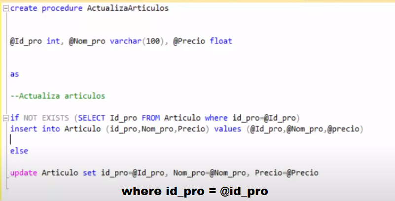
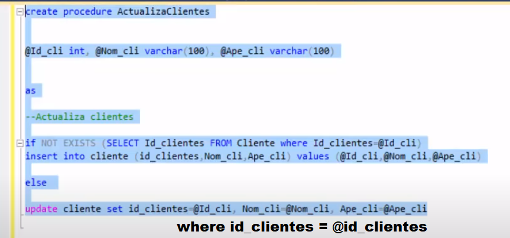

# El Buen Precio

A multi-cashier **client–server point-of-sale (POS) system** for a supermarket, built in **C#** with a custom **TCP + JSON messaging protocol**, **multithreading** (one thread per connected client), and a **SQL Server** backend.

This was my final project for the Advanced Programming course of the Informatics Engineering degree at **Universidad Estatal a Distancia de Costa Rica (UNED)** — the project where I learned C#, multithreading, and SQL from the ground up.

> ⚠️ Academic project (2021). Written with .NET Framework 4.7.2 and Windows Forms. Preserved here as a learning milestone — it demonstrates hand-built concurrency and a hand-rolled network protocol, without relying on any higher-level framework.

---

## What it does

A central **server** manages the store's catalog and sales, while multiple **cashier clients** connect over the network at the same time. Each cashier can log in, browse and search the product catalog, check stock availability in real time, and register (invoice) a sale. The server keeps a live log of every client action and a running count of connected cashiers.

Because every client is handled on its own thread, several cashiers can operate concurrently against the same SQL Server database — which is exactly what made this project a hands-on lesson in multithreading and shared-state access.

---

## Architecture

The system is split into four projects across three layers:

```
┌──────────────────────┐        TCP socket (127.0.0.1:16830)        ┌──────────────────────┐
│  ElBuenPrecioCliente │  ───  JSON "Mensajero<T>" messages,  ───▶  │ ElBuenPrecioServidor │
│  (WinForms cashier)  │        one line per request/response       │  (WinForms server)   │
└──────────────────────┘                                            └───────────┬──────────┘
                                                                                 │
                         ┌───────────────────────────────────────┐              │ ADO.NET
                         │        ElBuenPrecio.Entidades           │◀────────────┤
                         │  Shared models + Mensajero<T> envelope  │              ▼
                         └───────────────────────────────────────┘   ┌──────────────────────┐
                                                                      │   ElBuenPrecio.ADO    │
                                                                      │  (ADO.NET data layer) │
                                                                      └───────────┬──────────┘
                                                                                  ▼
                                                                          SQL Server database
```

| Project | Responsibility |
|---|---|
| **ElBuenPrecioServidor** | Windows Forms server. Opens a `TcpListener`, accepts clients, and spawns **one thread per client**. Dispatches incoming commands and updates a live activity log / connected-client counter. |
| **ElBuenPrecioCliente** | Windows Forms cashier app. Connects to the server, sends commands and renders catalog, stock checks, and invoicing. |
| **ElBuenPrecio.ADO** | Data-access layer. Raw **ADO.NET** (`SqlConnection` / `SqlCommand` / `SqlDataReader`) against SQL Server. The connection string is read from `App.config` — no credentials are hardcoded. |
| **ElBuenPrecio.Entidades** | Shared domain models (`Cajero`, `Producto`, `Categoria`, `Venta`, `DetalleDeVenta`, `TodaLaVenta`, `VerificadorDeStock`) plus the generic `Mensajero<T>` message envelope used by the protocol. |

### The messaging protocol

Client and server talk over a raw TCP stream using a small hand-built protocol. Every message is a JSON-serialized generic envelope, one message per line:

```csharp
Mensajero<T> {
    string Comando;   // the operation name, e.g. "Facturar"
    string Cliente;   // who is sending it
    T      Objeto;    // the typed payload
}
```

The server reads a line, deserializes it into a `Mensajero<T>`, and routes on `Comando`:

| Command | Action |
|---|---|
| `Conectar` | Log a cashier in (by ID) and report their activation state |
| `AgregarCajero` | Register a new cashier |
| `Desconectar` | Log a cashier out and update the connected count |
| `TodosLosProductos` | Return the full product catalog |
| `AlgunosProductos` | Search products by name |
| `HaySuficientes` | Check whether there is enough stock for a requested quantity |
| `Facturar` | Register a sale (invoice) and its line items |

Cross-thread UI updates (activity log, connected-client list, counter) are marshalled back onto the UI thread with `Control.Invoke` and delegates — so the per-client worker threads never touch WinForms controls directly.

---

## Database

SQL Server schema (`ElBuenPrecio.sql`) with five tables and referential integrity:

- **Cajero** — cashiers (id, name, assigned register, active flag)
- **Categoria** — product categories
- **Producto** — products (price, quantity on hand, FK → Categoria)
- **Venta** — sales headers (FK → Cajero, date, total)
- **DetalleDeLaVenta** — sale line items (FK → Venta, FK → Producto, unit price, quantity)

See `docs/Diagrama BD.PNG` for the entity-relationship diagram.

---

## Tech stack

- **Language:** C# (.NET Framework 4.7.2)
- **UI:** Windows Forms
- **Networking:** `System.Net.Sockets` (`TcpListener` / `TcpClient`), raw TCP streams
- **Concurrency:** `System.Threading.Thread`, one worker thread per client
- **Serialization:** Newtonsoft.Json
- **Data access:** ADO.NET against **SQL Server**

---

## Getting started

### Prerequisites

- Windows with **.NET Framework 4.7.2**
- **SQL Server** (Express is fine)
- Visual Studio 2019+ (the projects use `.sln` files)

### 1. Create the database

Run the script in SQL Server Management Studio:

```sql
-- ElBuenPrecio.sql
```

This creates the `ElBuenPrecio` database, its tables, and the foreign keys.

### 2. Configure the connection string

In **both** `ElBuenPrecioServidor` and `ElBuenPrecioCliente`, edit `App.config` and set the `cadenaDeConexion` connection string to point at your SQL Server instance:

```xml
<connectionStrings>
  <add name="cadenaDeConexion"
       connectionString="Data Source=YOUR_SERVER;Initial Catalog=ElBuenPrecio;Integrated Security=True"
       providerName="System.Data.SqlClient" />
</connectionStrings>
```

### 3. Run

1. Start **ElBuenPrecioServidor** first and click **Encender** — it begins listening on `127.0.0.1:16830`.
2. Start one or more **ElBuenPrecioCliente** instances and log in as a cashier.

`Manual.docx` contains the original step-by-step usage guide with screenshots.

---

## Screenshots

| Update products | Update clients |
|---|---|
|  |  |

---

## What I learned

This was the project where C#, multithreading, and SQL "clicked" for me:

- Designing a **stateful client–server protocol** from scratch over raw TCP, instead of using HTTP/REST or a framework.
- Handling **concurrent clients safely** with a thread-per-connection model, and marshalling results back to the UI thread.
- A clean **layered architecture** (shared entities · data access · server · client) with a reusable generic message envelope.
- Modeling a relational schema with proper keys and foreign keys, and talking to it with raw ADO.NET.

---

## Author

**Sergio Ignacio Saborío Segura**
Informatics Engineer — Universidad Estatal a Distancia de Costa Rica (UNED)
Advanced Programming final project · 2021
